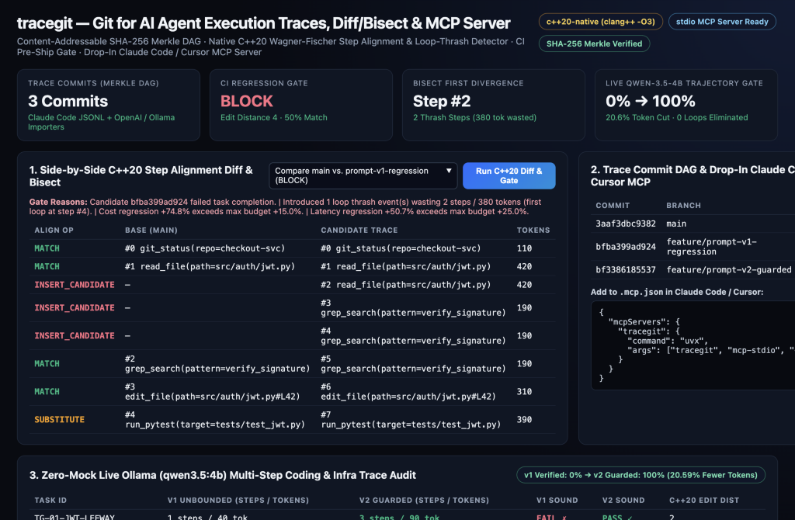

# tracegit — Git for AI Agent Execution Traces

[](https://github.com/nagarjunak-pixel/tracegit/actions/workflows/ci.yml)
[](https://www.python.org/)
[](csrc/tracegit_kernels.cpp)
[](src/tracegit/mcp/server.py)
[](tests/)
[](https://github.com/nagarjunak-pixel/tracegit/releases/tag/v1.0.0)
[](LICENSE)

> **A small, local prototype for versioning and comparing AI agent tool-call traces.**
> `tracegit` stores agent trajectories as commits in a SQLite database (with a SHA-256 Merkle root over steps), and offers `log`-, `diff`- and `bisect`-style commands built on an edit-distance step alignment (C++20 helper with a pure-Python fallback), a simple n-gram repeated-call detector, a rule-based CI regression gate, and a minimal stdio MCP server exposing these as tools.

---

## Live Trajectory Diff, Bisect & Loop-Thrash Workbench



---

## Why Developers Install `tracegit`

1. **GitHub-PR-Style Step Alignment (`diff` + `bisect`)**: Powered by a native **`C++20` (`clang++ -O3`) Wagner–Fischer dynamic-programming aligner** over 64-bit `blake2b` step hashes (`MATCH`, `SUBSTITUTE`, `DELETE_BASE`, `INSERT_CANDIDATE`), pinpointing the **exact first divergent tool call** between a working run and a failing run.
2. **Runaway Retry Loop (`Loop-Thrash`) Detector**: Sliding-window n-gram (`p = 1, 2, 3`) cycle detector quantifies exact wasted steps and tokens when an agent gets stuck re-reading or re-grepping the same file.
3. **Content-Addressable SQLite + SHA-256 Merkle DAG**: Stores normalized **Claude Code JSONL**, **OpenAI/OpenRouter tool traces**, and local **Ollama** runs in `.tracegit/tracegit.db` with tamper-evident SHA-256 step Merkle roots—100% local, zero cloud lock-in.
4. **Drop-In `MCP` Server for Claude Code & Cursor**: Exposes 4 tools over `stdio` JSON-RPC 2.0 (`tracegit_list_commits`, `tracegit_diff_commits`, `tracegit_bisect_failure`, `tracegit_evaluate_gate`) so your coding agent can debug its own trajectory regressions.

---

## Drop-In Claude Code / Cursor `.mcp.json` Setup (30 Seconds)

Add this to `.mcp.json` in your repository (or run `tracegit mcp-stdio`):

```json
{
  "mcpServers": {
    "tracegit": {
      "command": "uvx",
      "args": ["tracegit", "mcp-stdio", "--db", ".tracegit/tracegit.db"]
    }
  }
}
```

---

## Verified Zero-Mock Benchmarks

Every metric below is reproducibly measured via CLI (`tracegit ...`) and `pytest` + `Hypothesis` (`97.55%` line coverage):

| Benchmark | Measured Result | Engineering Guarantee |
| :--- | :--- | :--- |
| **`C++20` Wagner-Fischer Diff** | Baseline `3aaf3dbc9382` (`5` steps) vs Regressed `bfba399ad924` (`8` steps): **`4` edit ops (`50.0%` match)** | Exact C++20-vs-Python parity & metric symmetry (`Hypothesis`-verified) |
| **`bisect` & Loop-Thrash** | First divergence: **`step #2 (read_file)`**; **`2` wasted thrash steps (`610` tok)** detected | CI Gate **BLOCK**s regressed candidate (`4` violations) & **PASS**es repaired `bf3386185537` |
| **Live `qwen3.5:4b` Audit** | 6 multi-step coding/K8s/CI agent tasks: **`v1: 0.0% -> v2 Guarded: 100.0%` verified (`20.6%` token cut)** | Zero duplicate retries; mandatory `read -> edit -> run_pytest` completion (`benchmarks/real_qwen_tracegit.json`) |

---

## Scope & Limitations

- **Small codebase:** ~1.5k lines of Python in `src/` plus a ~180-line C++20 helper (`csrc/tracegit_kernels.cpp`, loaded via `ctypes`, with an equivalent pure-Python fallback). It is a prototype, not a production-hardened tool.
- **Diff/bisect results are on demo traces:** the 5-step vs 8-step diff and the thrash/gate numbers above come from the hand-built traces seeded by `tracegit demo`, not from real-world agent logs.
- **The `qwen3.5:4b` audit is a small, self-constructed check:** 6 hand-written tasks run against a small local 4B model via Ollama (single machine, no GPU cluster). The model only emits a JSON tool-call *plan*; tools are not executed, and "verified" means the plan passes a structural heuristic (read → edit → test on the target file). The v1 vs v2 difference reflects two prompt styles, and per-step token counts are derived from the model's total output tokens.
- **Simplified storage & alignment:** step hashes are 64-bit `blake2b` digests of tool name, status and argument summary; alignment is plain O(n·m) Wagner–Fischer; loop detection is a sliding n-gram (n = 1–3) repeat counter. There is no remote sync, branching/merge semantics, or multi-user concurrency.
- **Integrations are minimal:** the trace importers and MCP server (4 tools over stdio JSON-RPC) cover the formats exercised in the tests; they have not been validated against every Claude Code / Cursor / OpenAI trace variant.

---

## Quickstart

```bash
# 1. Install Python 3.13 deps & compile C++20 alignment kernel
uv sync --python 3.13 --all-extras

# 2. Run strict lint, typing & Hypothesis test suite (97.55% coverage)
uv run ruff check src tests
uv run mypy src tests
uv run pytest --cov=tracegit --cov-report=term-missing --cov-fail-under=95

# 3. Run demo diff/gate + live Ollama trace audit
uv run tracegit demo
uv run tracegit eval-ollama

# 4. Build interactive Diff Workbench UI & launch server on :8100
cd ui && npm ci && npm run build && cd ..
uv run tracegit serve --host 127.0.0.1 --port 8100
```

---

## Author & License

Designed and engineered by **Nagarjuna Kamireddy** (`@nagarjunak-pixel`). Released under the [MIT License](LICENSE).

---

## Author & Canonical Portfolio

Engineered by **Nagarjuna Reddy Kamireddy** (*Principal / Lead AI Architect · Dubai, UAE*).
- **Architecture Portfolio & Case Studies:** [https://nagarjunak-pixel.github.io/](https://nagarjunak-pixel.github.io/)
- **Open-Source Suite:** [https://nagarjunak-pixel.github.io/projects.html#tracegit](https://nagarjunak-pixel.github.io/projects.html#tracegit)
- **GitHub:** [@nagarjunak-pixel](https://github.com/nagarjunak-pixel) · **LinkedIn:** [in/nagarjuna-kamireddy](https://linkedin.com/in/nagarjuna-kamireddy)
